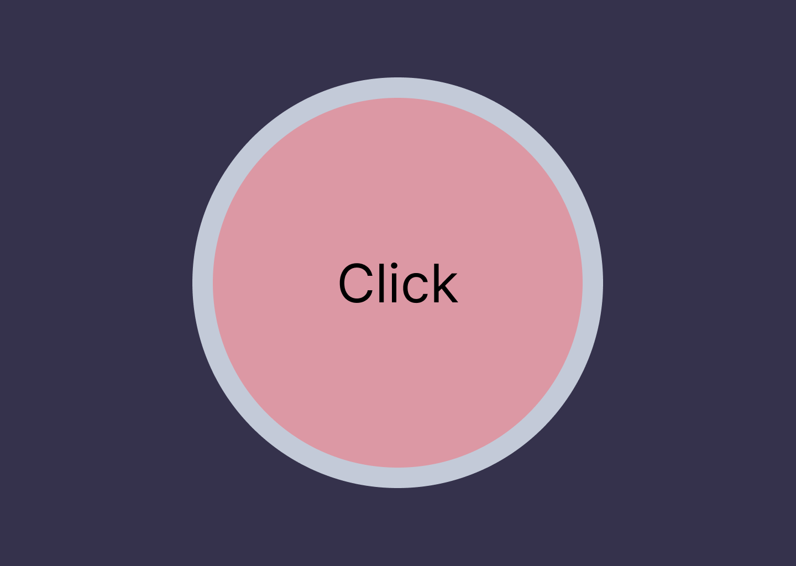
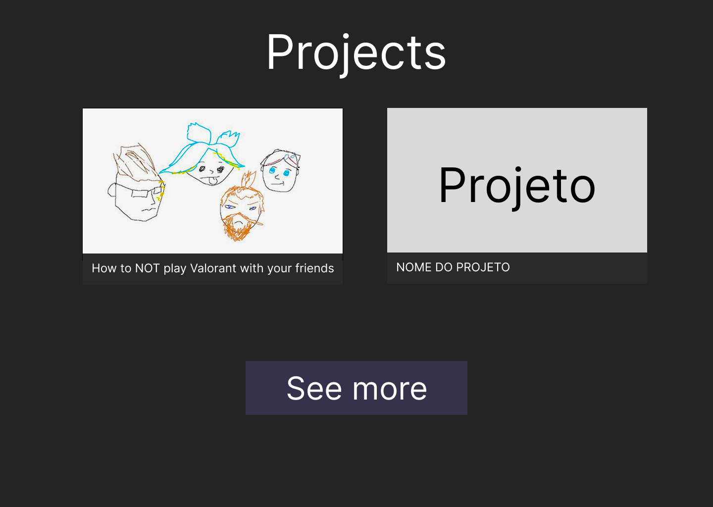
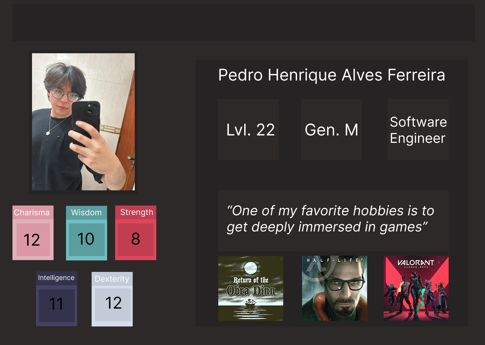
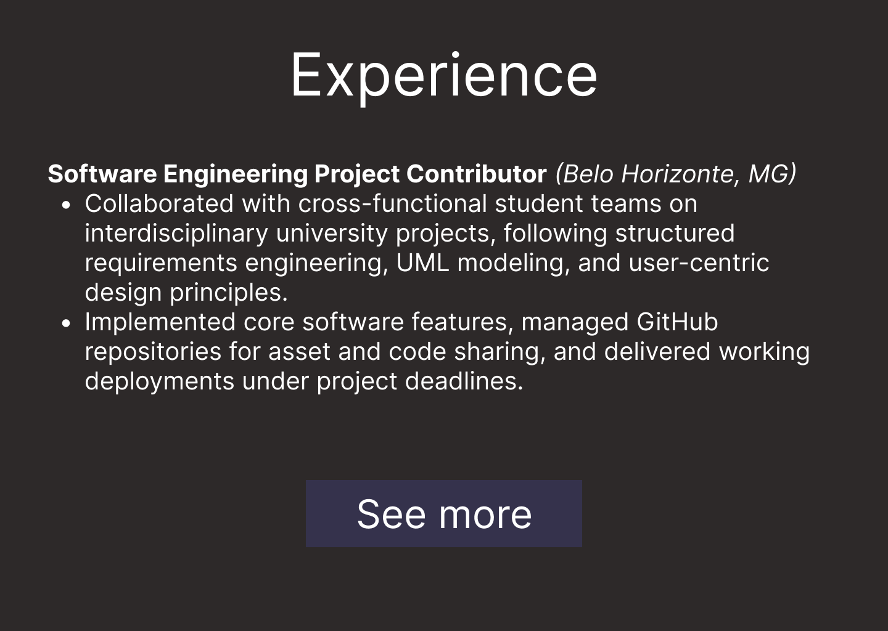
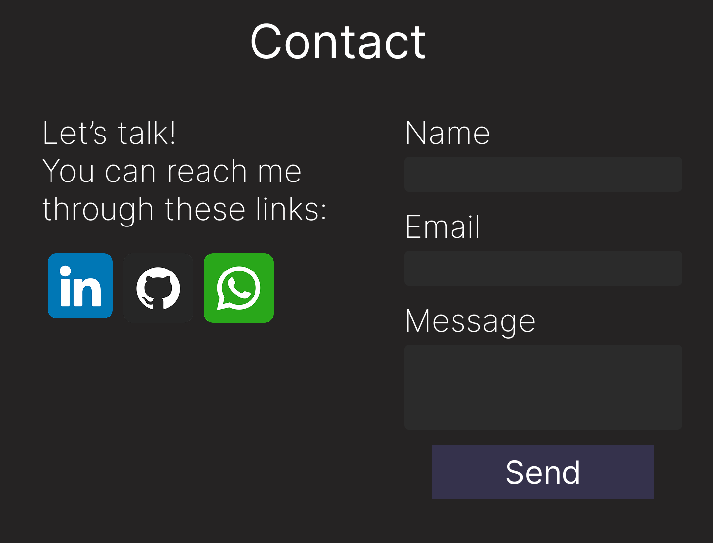

# Portfolio - Pedro Henrique Alves Ferreira

Portfólio pessoal e interativo desenvolvido para apresentar perfil profissional, projetos, experiência e formas de contato. A interface foi inspirada em elementos de jogos e utiliza uma navegação por seções reveladas progressivamente.

<div align="center">
  <a href="https://github.com/OPedroHAF/Portfolio">
    
  </a>
</div>

## Status do Projeto


## Índice

- [Sobre o Projeto](#sobre-o-projeto)
- [Funcionalidades](#funcionalidades)
- [Tecnologias](#tecnologias)
- [Arquitetura](#arquitetura)
- [Instalação e Execução](#instalação-e-execução)
- [Scripts Disponíveis](#scripts-disponíveis)
- [Estrutura de Pastas](#estrutura-de-pastas)
- [Demonstração](#demonstração)
- [Projetos em Destaque](#projetos-em-destaque)
- [Contato](#contato)
- [Autor](#autor)
- [Contribuição](#contribuição)
- [Licença](#licença)

## Sobre o Projeto

Este projeto é um portfólio pessoal criado para apresentar a trajetória de Pedro Henrique na área de Engenharia de Software de forma visual e acessível.

O site reúne:

- apresentação pessoal e atributos visuais;
- interesses em jogos;
- projetos desenvolvidos ou em andamento;
- experiência acadêmica e profissional;
- links para redes sociais;
- formulário de contato;
- páginas individuais com detalhes de cada projeto.

O projeto foi desenvolvido com React e Vite e atualmente é totalmente executado no front-end. O formulário de contato utiliza o serviço FormSubmit.

## Funcionalidades

- navegação progressiva por seções do portfólio;
- apresentação pessoal com foto, badges e atributos;
- seção dedicada a projetos;
- página de detalhes por rota;
- integração com vídeos do YouTube sem cookies;
- informações sobre experiência;
- links para LinkedIn, GitHub e WhatsApp;
- formulário de contato com envio por e-mail;
- alternância entre português e inglês, com preferência salva no navegador;
- layout responsivo;
- animações de transição entre as seções.

## Tecnologias

### Front-end

- **React** - construção da interface;
- **React Router DOM** - navegação entre o portfólio e páginas de projetos;
- **Vite** - servidor de desenvolvimento e build;
- **JavaScript** - lógica da aplicação;
- **CSS** - estilização e responsividade;
- **Axios** - dependência disponível no projeto para integrações HTTP futuras;
- **FormSubmit** - envio do formulário de contato.

### Desenvolvimento

- **npm** - gerenciamento de dependências;
- **Oxlint** - análise estática do código.

## Arquitetura

O projeto utiliza uma arquitetura simples baseada em componentes:

- `App.jsx` concentra as telas de portfólio e de detalhes dos projetos;
- o idioma pode ser alternado entre português e inglês; a preferência é persistida em `localStorage`;
- `projects.js` mantém os dados dos projetos em uma estrutura centralizada;
- `App.css` e `index.css` definem os estilos da aplicação;
- `assets/` contém imagens e ícones utilizados pela interface;
- `public/` contém recursos estáticos disponíveis diretamente pela aplicação;
- React Router resolve o acesso às rotas `/` e `/projects/:projectSlug`.

Não há back-end próprio neste repositório. Os dados exibidos são locais e o envio da mensagem é delegado ao FormSubmit.

## Instalação e Execução

### Pré-requisitos

- Node.js 20 ou superior;
- npm;
- Git.

### Clonando o repositório

```bash
git clone https://github.com/OPedroHAF/Portfolio.git
cd Portfolio
```

### Instalando as dependências

```bash
cd frontend
npm install
```

### Executando em desenvolvimento

```bash
npm run dev
```

A aplicação será iniciada na porta `3000`, conforme configurado em `vite.config.js`.

Para acessar:

```text
http://localhost:3000
```

### Gerando o build de produção

```bash
npm run build
```

Os arquivos de produção serão gerados na pasta `frontend/dist`.

### Visualizando o build localmente

```bash
npm run preview
```

## Scripts Disponíveis

Execute os comandos dentro da pasta `frontend`:

| Comando | Descrição |
|---|---|
| `npm run dev` | Inicia o servidor de desenvolvimento |
| `npm run build` | Gera o build de produção |
| `npm run preview` | Executa uma prévia local do build |
| `npm run lint` | Executa o Oxlint |

## Estrutura de Pastas

```text
Portfolio/
├── Artifacts/
│   └── Wireframes/          # Wireframes das principais telas
├── frontend/
│   ├── public/              # Arquivos estáticos públicos
│   ├── src/
│   │   ├── assets/          # Imagens e ícones importados
│   │   ├── App.css          # Estilos dos componentes
│   │   ├── App.jsx          # Páginas e componentes principais
│   │   ├── index.css        # Estilos globais
│   │   ├── main.jsx         # Inicialização do React
│   │   └── projects.js      # Dados e configuração dos projetos
│   ├── index.html
│   ├── package.json
│   └── vite.config.js
└── README.md
```

## Demonstração

Os wireframes disponíveis em `Artifacts/Wireframes` mostram a disposição planejada das telas principais.

| Seção principal | Projetos | Sobre mim |
|---|---|---|
|  |  |  |

| Experiência | Contato | Rodapé |
|---|---|---|
|  |  |  |

## Projetos em Destaque

### How to NOT play Valorant with your friends

Projeto voltado para momentos casuais e divertidos entre amigos no jogo Valorant. O vídeo foi gravado por 44 minutos e posteriormente editado com o CapCut.

- Vídeo publicado no YouTube;
- conteúdo totalmente editado;
- status: concluído.

### Cuida+

Projeto universitário desenvolvido com foco em uma solução prática e centrada no usuário para o cuidado em saúde.

- projeto em andamento;
- status: work in progress.

Os detalhes de ambos são carregados pela página `/projects/:projectSlug` utilizando os dados definidos em `projects.js`.

## Contato

- [LinkedIn](https://www.linkedin.com/in/pedro-henrique-alves-ferreira-67b56626a/)
- [GitHub](https://github.com/OPedroHAF)
- [WhatsApp](https://wa.me/5531991577033)

O formulário da aplicação envia mensagens por meio do FormSubmit para o e-mail configurado no projeto.

## Autor

**Pedro Henrique Alves Ferreira**

- GitHub: [@OPedroHAF](https://github.com/OPedroHAF)
- LinkedIn: [Pedro Henrique Alves Ferreira](https://www.linkedin.com/in/pedro-henrique-alves-ferreira-67b56626a/)
- Email: [evandroferreira191@gmail.com](mailto:evandrofreereira191@gmail.com)

## Contribuição

Contribuições são bem-vindas.

1. Faça um fork do repositório.
2. Crie uma branch:

   ```bash
   git checkout -b feature/minha-feature
   ```

3. Realize as alterações e faça commits claros:

   ```bash
   git commit -m "feat: adiciona minha funcionalidade"
   ```

4. Envie a branch:

   ```bash
   git push origin feature/minha-feature
   ```

5. Abra um Pull Request.

## Licença

Nenhuma licença foi definida explicitamente neste repositório. Entre em contato com o autor antes de reutilizar o código ou os recursos de forma pública.
